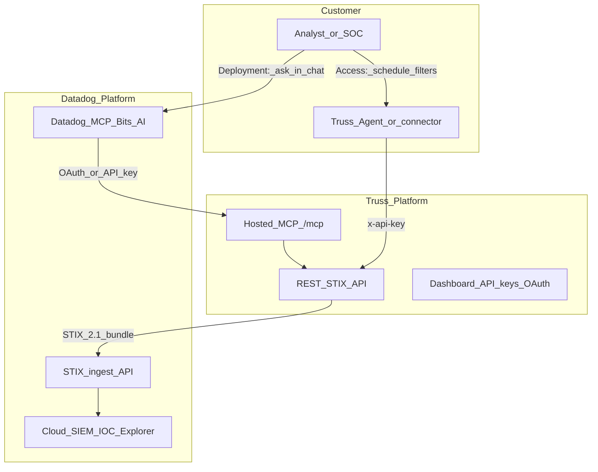
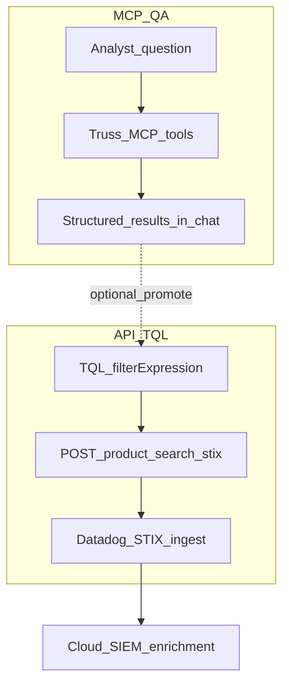
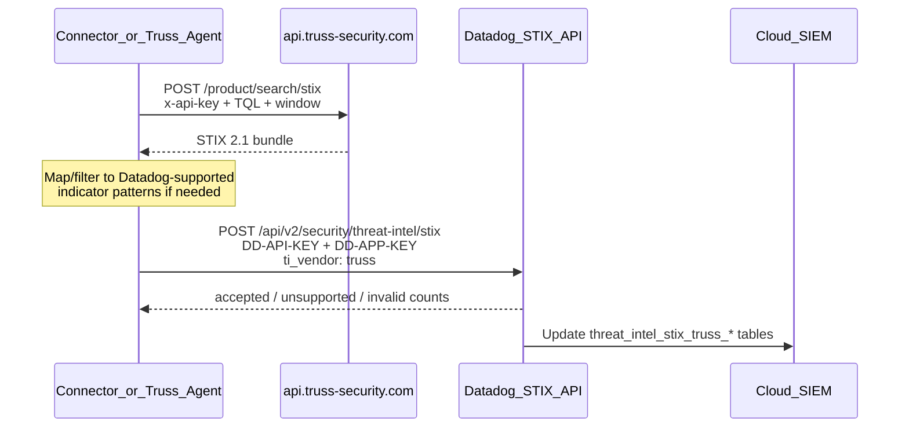

# Truss × Datadog integration partnership

**Status:** Partnership design (sandbox build)  
**Audience:** Truss + Datadog partnership / solutions engineering  
**Last updated:** October 2026

This document explains how Truss customers connect Truss' threat intelligence into the Datadog platform. It starts with the product model, then walks the technical architecture in the appendix.

**Canonical public docs (partner-facing):**

| Topic | URL |
|-------|-----|
| **Truss MCP** (OAuth, API-key bridge, tools, troubleshooting) | [docs.truss-security.com/data/mcp](https://docs.truss-security.com/data/mcp) |
| **Truss REST / TQL / STIX** | [docs.truss-security.com/data/api](https://docs.truss-security.com/data/api) |
| **TypeScript SDK** | [docs.truss-security.com/data/sdk](https://docs.truss-security.com/data/sdk) |

**Implementation ownership (engineering):** hosted `/mcp`, STIX mappers, and public product search live in **[truss-api](https://github.com/truss-security/truss-api)** (`documentation/architecture/mcp.md`, `src/handlers/mcpServer.ts`, `src/mcp/`, `src/handlers/searchProductsStix.ts`, `src/handlers/getProductStix.ts`). OAuth consent UX and Supabase migrations live in **truss-dashboard**. This package (`truss-agent-mcp`) ships host configs, `validate-remote` / `doctor --remote`, and optional local stdio—not the production MCP endpoint.

> **Naming notes:**
>
> - Current billing tiers are **Access** and **Deployment** (not “Development”). Access unlocks the REST API and Truss Agent–style automation. Deployment adds the hosted MCP endpoint for dynamic, LLM-driven queries. The live MCP guide still mentions legacy **Growth / Scale** labels in places; treat those as Access / Deployment respectively.
> - **TQL** = **Truss Query Language** (product name for the query language sent in API/`filterExpression` fields). Older docs may say “FilterQL”; treat them as the same language.

---

## 1. What the integration does

The partnership has two complementary jobs:

| Job | What the customer gets | Primary Truss surface |
|-----|------------------------|------------------------|
| **A. Automated TI delivery** | Scheduled / continuous Truss products pushed into Datadog Cloud SIEM as STIX 2.1 indicators for log enrichment and IOC Explorer | Public REST API (`/product/search/stix`, `/product/{id}/stix`) — see [Truss API docs](https://docs.truss-security.com/data/api) |
| **B. Dynamic investigation** | On-demand, natural-language queries of Truss from an MCP-capable host (Datadog AI workflows, Cursor + Datadog MCP, Bits AI–style agents, custom agents) | Hosted MCP (`https://api.truss-security.com/mcp`) — see [Truss MCP docs](https://docs.truss-security.com/data/mcp) |

Job A is the “Truss Agent–like” path: fixed filters, schedules, deterministic push.  
Job B is the “ask Truss anything right now” path: the LLM chooses tools and TQL/STIX calls at query time.

Both jobs can run for the same customer. Subscription tier controls which surfaces they may use.

---

## 2. Subscription model (high level)

| Truss plan | API key + REST / STIX | Truss Agent–style automation | Hosted MCP (dynamic queries) |
|------------|----------------------|------------------------------|------------------------------|
| **Community** | No | No | No |
| **Access** | Yes | Yes | No (OAuth consent denied; MCP eligibility blocked) |
| **Deployment** | Yes | Yes | Yes (OAuth and/or API key on `/mcp`) |
| **Enterprise** | Yes (often multi-key / MSSP) | Yes | Yes |

### Access — automate like Truss Agent

1. After purchasing **Access**, **Deployment**, or **Enterprise**, the customer’s API key is provisioned with the subscription. They retrieve it from [dashboard.truss-security.com/api-key](https://dashboard.truss-security.com/api-key).
2. A connector (Truss Agent today, or a future Datadog-facing adapter / marketplace app) runs on a schedule, using that key as `x-api-key`.
3. It queries Truss with **TQL** (Truss Query Language) over the public STIX routes.
4. It posts STIX 2.1 indicator bundles to Datadog’s threat-intel ingest API.
5. Datadog materializes reference tables and enriches Cloud SIEM logs; analysts see Truss IOCs in IOC Explorer.

No LLM is required. Behavior is deterministic: same filter → same class of results → push.

### Deployment — automate **and** query dynamically via MCP

Everything in Access, plus (per [Truss MCP](https://docs.truss-security.com/data/mcp)):

1. After purchasing **Deployment** or **Enterprise** the customer (or Datadog-hosted agent) connects to Truss **hosted MCP** at `https://api.truss-security.com/mcp`.
2. Authentication is through Truss' **OAuth** (host opens browser → dashboard consent at `/oauth/consent`); `x-api-key` is the documented alternative for bridges / automation.
3. The host LLM calls Truss tools (`lookup_ioc`, `search_threats`, `get_product`, `get_product_stix`, `search_stix`, …) in response to analyst questions.
4. Results stay in the investigation loop (chat, playbook, ticket). Separately, the customer can still run Job A to keep Datadog’s TI tables fresh.



NOTE: We need to ask if DataDog has an API Query capability of its own. Essentially, can DataDog be its own Agent and pull on a cron schedule?

---

## 3. How the interaction works (narrative)

### 3.1 Shared foundation

Both tiers talk to the same Truss product corpus. The public customer boundary is:

- `POST /product/search` — product JSON search (TQL in `filterExpression`)
- `POST /product/search/stix` — search results as STIX 2.1
- `GET /product/{id}/stix` — one product as STIX 2.1

Hosted MCP tools are a **thin, agent-friendly façade** over that same data (plus a few convenience tools such as IOC pivot and native JSON product fetch on the hosted surface). Metering remains on Truss API Gateway usage plans.

### 3.2 Access path — “push TI into Datadog” (Without the integration we can't pull Truss from DataDog, we can only push)

Think of this as **Truss → Datadog** (egress from the customer’s automation into Datadog).

1. **Auth to Truss:** `x-api-key: <TRUSS_API_KEY>` from [dashboard → API key](https://dashboard.truss-security.com/api-key) (issued with Access / Deployment / Enterprise; not customer-created).
2. **Query:** connector builds a **TQL** expression (same shape as dashboard export / Truss Agent jobs), typically with a rolling window (default guidance: ~7 days unless the customer widens it).
3. **Shape:** prefer STIX search so the payload is already a STIX 2.1 bundle of indicators Datadog can ingest.
4. **Auth to Datadog:** `DD-API-KEY` + `DD-APPLICATION-KEY` (app key needs Reference Tables Write).
5. **Deliver:** `POST https://api.<site>/api/v2/security/threat-intel/stix` with header `ti_vendor` identifying the feed (≤10 chars after Datadog normalization; partnership target e.g. `truss`).
6. **Consume:** Datadog creates/updates tables such as `threat_intel_stix_truss_ip_address`, enables enrichment, and surfaces indicators in IOC Explorer.

Updates and revocations follow Datadog’s STIX rules (resend to update; `"revoked": true` to delete).

### 3.3 Deployment path — “pull Truss on demand from Datadog’s AI surface”

Think of this as **Datadog AI host → Truss MCP** (ingress of investigation queries). Customer/setup steps match [Connect with OAuth](https://docs.truss-security.com/data/mcp#connect-with-oauth-recommended) on the public MCP guide.

1. Host contacts `https://api.truss-security.com/mcp` (sandbox: `https://api-test.truss-security.com/mcp`).
2. Truss returns OAuth discovery metadata; the browser opens Truss login + **Connect Truss MCP** consent (`dashboard.truss-security.com/oauth/consent`). Only **Deployment+** (legacy Growth/Scale on the public page) can approve.
3. After Allow access, the host stores tokens, lists tools, and the LLM issues `tools/call` for IOC lookups, threat search, product detail, or STIX export.
4. Optionally, the same session can use **Datadog’s own MCP** (logs, signals, IOC Explorer) so the agent correlates “what Datadog saw” with “what Truss knows” without the analyst copying IOCs by hand.

For hosts that cannot do remote OAuth yet, use the [API key alternative](https://docs.truss-security.com/data/mcp#connect-with-an-api-key-alternative) (`x-api-key` on the same `/mcp` URL).

Deployment customers who also want continuous enrichment still run the Access-style STIX push; MCP does **not** replace scheduled feed delivery.

### 3.4 What does *not* happen on hosted MCP

Per Truss architecture:

- Hosted MCP does **not** store Datadog credentials or push to Datadog.
- Push into Datadog is always **customer-side egress** (Agent / connector / marketplace app) using the customer’s Datadog keys.
- Admin-only Truss routes (smart/vector search, writes, etc.) are out of scope for this partnership.

---

## 4. Use cases — API (TQL) vs MCP (dynamic Q&A)

Two integration modes. Do not mix their contracts:

| Mode | How the customer asks Truss | What comes back | Datadog role | Tier |
|------|----------------------------|-----------------|--------------|------|
| **API** | Explicit **TQL** filter in `filterExpression` (scheduled or scripted) | Deterministic product / STIX result sets | Push STIX → enrich Cloud SIEM | Access+ |
| **MCP** | Natural-language Q&A; host LLM picks tools | Dynamic answers + tool results (`lookup_ioc`, `search_threats`, `get_product`, STIX tools, …) | Investigate beside signals/logs; optional handoff to an API schedule | Deployment+ |



Truss does **not** open Datadog alerts or cases by itself. API enrichment feeds detection/investigation; MCP answers questions in the moment.

### 4.1 Where enriched / investigated data shows up in Datadog

| Datadog surface | Fed mainly by | Notes |
|-----------------|---------------|-------|
| **Cloud SIEM logs** (TI metadata) | **API** STIX push | Match on IP / domain / SHA-256 after reference tables are enabled |
| **IOC Explorer** | **API** STIX push | Browse Truss indicators; pivot to logs/signals |
| **Detection rules → security signals** | **API** enrichment | Rules query `@threat_intel…` (etc.); Truss does not post alerts |
| **Case Management** | Signals from enriched logs | Cases assigned by operators/automation |
| **AI investigation chat** | **MCP** Q&A | Dynamic Truss context next to Datadog signal/log context |

---

### 4.2 API use cases — require a TQL filter to return data

Every API UC starts with a concrete **TQL** expression (same language as dashboard / Truss Agent). No TQL → no search body that returns products/STIX for Datadog.

#### API-UC-1 — Scheduled continuous enrichment

**TQL:** Durable filter, e.g. campaign or malware scope, plus a rolling `days` / date window.  
**Call:** `POST /product/search/stix` with `filterExpression` + window → connector posts bundle to Datadog STIX ingest (`ti_vendor: truss`).  
**Datadog outcome:** Reference tables stay warm; new matching logs are enriched; indicators appear in IOC Explorer.  
**Tier:** Access+

#### API-UC-2 — Topic-scoped feed (ransomware, sector, source)

**TQL:** Narrow expression (title/category/tags/industry/source, …) so only a slice of Truss is exported.  
**Call:** Same STIX search + scheduled push as API-UC-1.  
**Datadog outcome:** Leaner `threat_intel_stix_truss_`* tables; lower noise in enrichment and IOC Explorer.  
**Tier:** Access+

#### API-UC-3 — High-fidelity detections on enriched logs

**TQL:** Whatever filter powers the feed that populated the tables (API-UC-1/2).  
**Datadog side:** Detection rules require TI facets on enriched logs → **security signals**.  
**Outcome:** Alerts grounded in Truss indicators already delivered via TQL→STIX; Truss API does not create the signal.  
**Tier:** Access+

#### API-UC-4 — Case handoff from TQL-backed signals

**TQL:** Same feed as above.  
**Datadog side:** Assign a Truss-enriched signal into Case Management.  
**Outcome:** Case timeline includes enriched logs / IOC pivots from the API-fed tables.  
**Tier:** Access+

#### API-UC-5 — One-shot or scripted STIX export

**TQL:** Ad-hoc but still explicit filter (ops script, SOAR action, partner tile “run now”).  
**Call:** `POST /product/search/stix` or `GET /product/{id}/stix` → immediate Datadog ingest batch.  
**Outcome:** Controlled refresh without MCP; still requires the caller to supply TQL (or a product id from a prior TQL search).  
**Tier:** Access+

**API contract reminder:** Allowed body fields include `filterExpression` (TQL), `startDate`/`endDate` or `days`, `page`, `limit`, `order_by`, `order_direction` — see [Truss API docs](https://docs.truss-security.com/data/api).

---

### 4.3 MCP use cases — dynamic Q&A and return of results

Every MCP UC starts with a **question** (or host prompt). The LLM selects tools and arguments; the analyst does not have to author TQL up front ([Truss MCP](https://docs.truss-security.com/data/mcp)).

#### MCP-UC-1 — “What does Truss know about this IOC?”

**Question:** e.g. “Is `198.51.100.10` in Truss?” / “Look up this domain from the Datadog signal.”  
**Tools:** Typically `lookup_ioc`, then `get_product` / `get_product_stix` as needed.  
**Return:** Structured match list + product detail in the chat/investigation UI.  
**Datadog link:** IOC copied from a signal, log, or IOC Explorer row.  
**Tier:** Deployment+

#### MCP-UC-2 — Open-ended threat discovery beside Datadog

**Question:** e.g. “Recent ransomware infrastructure Truss has on banking” / “Summarize Malware products last 7 days.”  
**Tools:** `search_threats` (and `search_stix` if STIX is needed).  
**Return:** Ranked products / summaries / optional STIX bundle in the conversation—not a pre-saved TQL job.  
**Tier:** Deployment+

#### MCP-UC-3 — Signal / case investigation assist

**Question:** Analyst (or Bits AI–style host) pastes signal context and asks for Truss narrative, related IOCs, or STIX for the case notes.  
**Tools:** Mix of `lookup_ioc`, `search_threats`, `get_product`, STIX tools.  
**Return:** Q&A answer plus citeable product ids/titles for the case timeline.  
**Tier:** Deployment+

#### MCP-UC-4 — Dual-MCP correlation (Datadog MCP + Truss MCP)

**Question:** “From this Cloud SIEM signal, pull the matched IOC from Datadog, then ask Truss what it knows.”  
**Flow:** Datadog MCP for signal/log/IOC context → Truss MCP for TI Q&A → single agent thread.  
**Return:** Combined answer; no Truss credentials stored in Datadog MCP and no Datadog keys stored in Truss.  
**Tier:** Deployment+

#### MCP-UC-5 — Promote Q&A findings into an API TQL schedule

**Question:** Interactive hunt via MCP finds a durable pattern the SOC wants continuously.  
**Return:** Analyst (or playbook) turns the effective search into an explicit **TQL** filter and saves it on the Access-style connector (API-UC-1/2).  
**Outcome:** Dynamic Q&A becomes deterministic API enrichment. MCP does not replace the scheduled TQL job.  
**Tier:** Deployment+ to discover; Access+ to run the lasting feed

---

### 4.4 What each mode does *not* do

| Expectation | Reality |
|-------------|---------|
| API returns useful search data without TQL (or equivalent structured filters / product id) | No — API UCs require a TQL `filterExpression` (or id from a prior TQL result) |
| MCP requires the analyst to write TQL first | No — MCP is dynamic Q&A; the host may derive filters internally |
| MCP writes to Datadog TI tables by itself | No — query-only; push to Datadog remains customer egress (usually API+STIX) |
| Truss STIX ingest creates Datadog monitors/alerts or cases | No — enrichment only; signals/cases are Datadog workflow |
| Historical logs are retro-enriched | No — enrichment applies after tables are enabled |

### 4.5 Demo script (joint partnership)

1. **API:** Run a TQL → STIX batch → confirm `threat_intel_stix_truss_`* tables and an IOC in IOC Explorer → show enriched log → optional signal/case.
2. **MCP:** From that signal’s IOC, ask the AI host a natural-language question via Truss MCP and show returned products.
3. **Handoff:** Turn the successful MCP hunt into a saved TQL schedule for continuous API enrichment.

---

## 5. Sandbox build guidance

| Environment | Truss REST / STIX | Truss hosted MCP |
|-------------|-------------------|------------------|
| **Production** | `https://api.truss-security.com` | `https://api.truss-security.com/mcp` |
| **Test / developer sandbox** | `https://api-test.truss-security.com` | `https://api-test.truss-security.com/mcp` |

Recommended partner build order:

1. **STIX connectivity (Access-equivalent key)** — prove TQL → STIX bundle → Datadog ingest → reference tables / IOC Explorer ([API guide](https://docs.truss-security.com/data/api); **truss-api** STIX handlers).
2. **MCP connectivity (Deployment-equivalent key / OAuth user)** — follow [Truss MCP](https://docs.truss-security.com/data/mcp): Connect → dashboard Allow access → prove tool list + `lookup_ioc` / `search_stix` from a Datadog-capable MCP host (served by **truss-api** `/mcp`).
3. **Joint demo** — scheduled Truss feed enriching Datadog SIEM **and** an analyst asking Datadog’s AI to pivot a Datadog signal into Truss context via MCP.

Validate hosted MCP with:

```bash
truss-mcp validate-remote https://api-test.truss-security.com/mcp --strict-oauth
# or production:
truss-mcp doctor --remote --strict-oauth
```

---

## 6. Customer journey summary

| Customer question | Access | Deployment |
|-------------------|--------|------------|
| “Keep Datadog enriched with Truss IOCs every hour.” | Yes — API + connector | Yes — same |
| “Ask my AI: what does Truss know about this IP from a Datadog signal?” | No — upgrade for MCP | Yes — hosted MCP |
| “Use Cursor with both Datadog MCP and Truss MCP.” | Datadog MCP only for DD data; Truss MCP blocked | Both |
| “Air-gapped / local stdio only.” | Local `truss-mcp mcp` with API key (investigation); push still local | Same + may prefer remote OAuth for interactive hosts |

---

# Appendix A — Technical architecture

## A.1 Component map

| Component | Owner | Role in this integration |
|-----------|-------|---------------------------|
| Truss public REST / STIX | **[truss-api](https://github.com/truss-security/truss-api)** (`searchProductsStix`, `getProductStix`, `src/stix/`) | Product / STIX search for Access automation |
| Truss hosted MCP | **[truss-api](https://github.com/truss-security/truss-api)** (`src/handlers/mcpServer.ts`, `src/auth/mcpAuth.ts`, `src/mcp/`, `mcpProtectedResource`) | Streamable HTTP `/mcp`; dual auth; tool handlers |
| MCP architecture notes | **truss-api** `documentation/architecture/mcp.md` | Internal engineering reference for OAuth, metering, tools |
| Public MCP guide | [docs.truss-security.com/data/mcp](https://docs.truss-security.com/data/mcp) | Partner/customer setup (OAuth, API key, tools, troubleshooting) |
| Truss dashboard OAuth consent | **truss-dashboard** `/oauth/consent` | Deployment+ gate for interactive MCP |
| Host configs / remote doctor | **truss-agent-mcp** (this repo) | `validate-remote`, Cursor samples; does **not** host `/mcp` |
| Truss Agent / future Datadog connector | Customer or partnership deliverable | Schedule + TQL + STIX push to Datadog |
| Datadog STIX ingest | Datadog | `POST /api/v2/security/threat-intel/stix` |
| Datadog Cloud SIEM / IOC Explorer | Datadog | Enrichment + analyst UI |
| Datadog MCP / Bits AI | Datadog | Host that may call Truss MCP (Deployment) |

## A.2 Access: sequence (STIX push)



### A.2.1 Truss request (illustrative)

```http
POST /product/search/stix HTTP/1.1
Host: api.truss-security.com
x-api-key: <TRUSS_API_KEY>
Content-Type: application/json

{
  "filterExpression": "title LIKE '%ransomware%'",
  "days": 7,
  "page": 1,
  "limit": 50
}
```

Allowed query fields align with the public contract: `filterExpression`, `startDate`/`endDate` or `days`, `page`, `limit`, `order_by`, `order_direction`. See [Truss API docs](https://docs.truss-security.com/data/api) and [02 — Public API contract](./02-public-api-contract.md). Handlers in **truss-api**: `src/handlers/searchProductsStix.ts`, `src/handlers/getProductStix.ts`.

### A.2.2 Datadog ingest (illustrative)

```http
POST /api/v2/security/threat-intel/stix HTTP/1.1
Host: api.datadoghq.com
DD-API-KEY: <DD_API_KEY>
DD-APPLICATION-KEY: <DD_APP_KEY>
ti_vendor: truss
Content-Type: application/json

{ "type": "bundle", "id": "bundle--…", "objects": [ /* STIX 2.1 indicators */ ] }
```

**Datadog constraints the connector must respect:**

| Constraint | Implication for Truss → Datadog |
|------------|----------------------------------|
| STIX **2.1** only | Use Truss STIX routes; reject / skip other specs |
| Indicator types: IPv4, IPv6, domain, SHA-256 | Filter or transform Truss bundles; count `unsupported` |
| Patterns: `=`, `IN`, `OR` (no `AND` across brackets, no wildcards/regex) | Prefer exact IOC patterns from Truss indicators |
| Body ≤ 50 MB (gzip optional) | Page Truss search; batch Datadog posts |
| `ti_vendor` ≤ 10 chars (normalized) | Use a short stable id such as `truss` |
| 10 req/s per Datadog API key | Back off on `429` |

Optional: set `valid_until` when Truss provides expiry semantics so Datadog auto-expires indicators.

## A.3 Deployment: sequence (MCP query)

```mermaid
sequenceDiagram
  participant Host as Datadog_AI_or_MCP_host
  participant MCP as api.truss-security.com/mcp
  participant AS as Truss_OAuth_AS
  participant User as Deployment_user
  participant API as Truss_REST_backend

  Host->>MCP: MCP request without token
  MCP-->>Host: 401 + WWW-Authenticate
  Host->>MCP: GET /.well-known/oauth-protected-resource
  Host->>AS: Auth Code + PKCE<br/>resource=https://api.truss-security.com/mcp
  AS->>User: Login + /oauth/consent
  Note over User: Access users auto-denied;<br/>Deployment+ may consent
  AS-->>Host: access_token
  Host->>MCP: tools/call search_stix / lookup_ioc …
  MCP->>API: Authenticated product/STIX fetch
  API-->>MCP: Results
  MCP-->>Host: Tool result for LLM
```

### A.3.1 Hosted MCP tool surface

Partner-facing catalog: [Available tools](https://docs.truss-security.com/data/mcp#available-tools) on the public MCP guide. Implementation: **truss-api** `src/mcp/server.ts` (registered on `POST /mcp` via `src/handlers/mcpServer.ts`).

| Tool | Purpose |
|------|---------|
| `lookup_ioc` | Check one IP, domain, URL, or hash against Truss products |
| `search_threats` | Structured product discovery (category, region, source, tags, …) |
| `get_product` | Product detail (JSON) after search returns an id |
| `get_product_stix` | Product detail (STIX 2.1) |
| `search_stix` | Search results as STIX 2.1 |

The public guide may also list delivery-helper tools (for example Discord scheduler recipes). Those are not part of the Datadog STIX ingest path; Datadog Job A still uses REST STIX → Datadog ingest.

Dual auth on `/mcp` (as documented publicly and in **truss-api** `mcpAuth`): `Authorization: Bearer <oauth>` **or** `x-api-key`. Access-tier keys remain **MCP-ineligible** even if presented.

### A.3.2 Dual-MCP investigation pattern

A Deployment customer’s AI client can register **both**:

```json
{
  "mcpServers": {
    "datadog": { "url": "https://mcp.datadoghq.com/…" },
    "truss": { "url": "https://api.truss-security.com/mcp" }
  }
}
```

Typical agent loop:

1. Datadog MCP: fetch signal / matched IOC from Cloud SIEM.
2. Truss MCP: `lookup_ioc` or `search_stix` on that value.
3. Optional: human or playbook promotes a durable **TQL** filter into the Access-style scheduled connector so enrichment stays warm without repeated chat queries.

Exact Datadog MCP URL and toolset enablement follow [Datadog MCP Server](https://docs.datadoghq.com/mcp_server/) and [Security MCP tools](https://docs.datadoghq.com/security/mcp_server/) docs (e.g. `toolsets` including `security`).

## A.4 Auth and eligibility matrix

| Credential | REST `/product/*` | Hosted `/mcp` | Notes |
|------------|-------------------|---------------|-------|
| Community (no key) | No | No | |
| Access API key | Yes | No | Same AWS usage plan id as Deployment; role tag blocks MCP |
| Deployment API key | Yes | Yes (`x-api-key`) | Machine MCP clients |
| Deployment OAuth token | N/A (REST is key-based) | Yes (Bearer) | Interactive hosts; consent required |
| Enterprise | Yes | Yes | Often custom key / seat topology |

OAuth `resource` (RFC 8707) must be the MCP URL itself (`https://api.truss-security.com/mcp` or the matching test host).

## A.5 Security and data-flow rules

1. **Truss API keys never appear in MCP tool arguments** — only in host env, connector secret store, or OAuth tokens.
2. **Datadog keys never enter Truss** — push is customer egress only.
3. **Default search windows stay narrow** (~7 days) unless the customer explicitly widens (quota).
4. **IOC-safe summaries** on investigation tools unless the caller opts into full indicators (local stdio / product policy); STIX push paths intentionally carry indicators Datadog needs for enrichment.
5. Report Truss-side issues per [SECURITY.md](../SECURITY.md).

## A.6 Implementation options for the connector

| Option                                            | Fits                      | Notes                                                                                                                        |
| ------------------------------------------------- | ------------------------- | ---------------------------------------------------------------------------------------------------------------------------- |
| **Truss Agent job** with Datadog STIX destination | Access+ today / near-term | Aligns with existing schedule + TQL model; add Datadog adapter                                                               |
| **Marketplace / Integration tile** in Datadog     | Productized partnership   | Customer pastes the subscription-issued API key (from dashboard `/api-key`) + TQL; Datadog or Truss-hosted worker pulls STIX |
| **Customer script / SOAR**                        | DIY                       | Same REST → STIX ingest contract                                                                                             |
| **Local** `truss-mcp` **delivery merge**          | Longer-term               | See [07 — Unified agent delivery](./07-unified-agent-delivery-architecture.md); hosted MCP stays query-only                  |

## A.7 Non-goals for v1 partnership

- Hosting Datadog credentials inside Truss hosted MCP
- Bidirectional sync of Datadog detections *into* Truss product storage
- Exposing Truss admin search routes through Datadog
- Guaranteeing every Truss STIX object type maps 1:1 into Datadog (connector must filter to supported indicator patterns)

---

# Appendix B — Quick reference links

| Topic | Link |
|-------|------|
| **Truss MCP (public, canonical)** | [docs.truss-security.com/data/mcp](https://docs.truss-security.com/data/mcp) |
| **Truss REST / TQL / STIX (public)** | [docs.truss-security.com/data/api](https://docs.truss-security.com/data/api) |
| **truss-api** (hosted `/mcp` + STIX handlers) | [github.com/truss-security/truss-api](https://github.com/truss-security/truss-api) · `documentation/architecture/mcp.md` |
| Hosted MCP / OAuth (this-repo deep dive) | [05 — Hosted MCP OAuth](./05-hosted-mcp-oauth-architecture.md) |
| Public REST contract (stdio boundary) | [02 — Public API contract](./02-public-api-contract.md) |
| TQL for agents | [03 — FilterQL for LLMs](./03-filterql-for-llms.md) (TQL grammar; filename historical) |
| Local stdio tools | [04 — MCP tool catalog](./04-mcp-tool-catalog.md) |
| Agent vs MCP product split | [guides/truss-agent-vs-mcp.md](../guides/truss-agent-vs-mcp.md) |
| Datadog STIX ingest guide | [Ingest STIX Threat Intelligence](https://docs.datadoghq.com/security/cloud_siem/guide/ingest-stix-threat-intelligence/) |
| Datadog STIX API | [Threat Intelligence API](https://docs.datadoghq.com/api/latest/threat-intelligence/) |
| Datadog MCP overview | [Datadog MCP Server](https://docs.datadoghq.com/mcp_server/) |

---

**Prev:** [07 — Unified agent delivery](./07-unified-agent-delivery-architecture.md) · [Docs index](./README.md)
